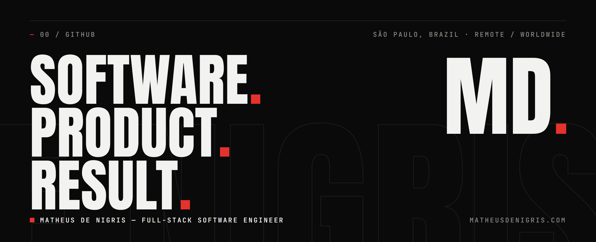
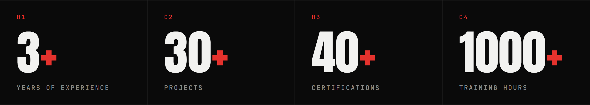

  
  
  
  

## — 01 / About

I write **software** the way you build a **product**: start from the problem, measure what matters and ship fast.

Truly **full-stack**, from the database to the last pixel, with **AI** where it solves things and not where it decorates. The result is code that holds up as it grows and products people actually use.

- ✈️ **Full-Stack Engineer at KODES Tech**, placed with **Kontik**, a client in the aviation sector.
- 🏢 Previously **3 years at IT Works** (2023 – 2026), from front-end to full-stack, as lead developer across five production applications for tax compliance and fiscal document management.
- 🚀 **Founder of [Commitfolio](https://commitfolio.com)**, a SaaS that turns your GitHub commits into an ATS-safe résumé.
- 🎓 **Software Engineering at FIAP** (2024 – 2027), after a Science & Technology foundation at UFABC.
- 🌎 Based in **São Paulo, Brazil**. Working remotely with clients worldwide in **Portuguese, English and Spanish**.

## — 02 / What I ship

| | Service | What you get |
|---|---|---|
| 🌐 | **Web development** | Websites, landing pages and web apps that are fast, accessible and ready to scale. |
| 📱 | **Mobile development** | Android and iOS apps with React Native and native Android, from prototype to the stores. |
| ☁️ | **SaaS development** | Complete SaaS products: auth, plans and billing, multi-tenant, observability and cloud deploy. |
| 🤖 | **AI integrations** | Process automation, virtual assistants and AI agents wired into what the company already uses: WhatsApp, email, CRM, ERP and spreadsheets. |
| 🎤 | **Talks & events** | Talks, panels, workshops and meetups on software engineering, applied AI and tech careers. |

## — 03 / Commitfolio

> **Your commits become the CV.**

[**Commitfolio**](https://commitfolio.com) is my own product. It generates a tailored, ATS-safe résumé for each job from your GitHub commits, your LinkedIn experience and the job description. Every bullet on the CV carries the commit that proves it.

| Step | | |
|---|---|---|
| **01** | **GitHub + LinkedIn** | Connect GitHub and import your LinkedIn experience. Your commits become facts about what you really shipped. |
| **02** | **Job** | Paste the job description. Commitfolio extracts keywords and requirements and computes the match in real time. |
| **03** | **ATS CV** | Get an ATS-safe CV with the commit hash on each bullet, a live checklist and PDF export. |

`Commit evidence on every bullet` · `Live checklist` · `Match % with the job` · `PT / EN / ES` · `PDF export`

## — 04 / Work

**In production**

| Project | Where | What I did |
|---|---|---|
| **Tax intelligence platform** | IT Works · 2023 – 2026 | Web platform + mobile app for tax compliance, as lead developer. |
| **Internal operations tool** | IT Works | Mobile-first tool with dashboards and observability. |
| **Legacy product migration** | IT Works | Moved a legacy product to the web. |
| **Landing pages with checkout** | IT Works | Sales pages with checkout running on AWS. |
| [**Grupo SERCA**](https://www.gruposerca.com.br) | Freelance · International trade | Institutional landing page in PT / EN / ES. |
| [**À Medida Labs**](https://www.amedidalabs.pt) | Freelance · Automation & AI · Portugal | International project: landing page in European Portuguese for the Portuguese market. |

**On GitHub**

| Repository | About |
|---|---|
| [**armstrong-maps**](https://github.com/matheusdenigris/armstrong-maps) | A layered map of Mars for planning and following walks on the surface. React Native app for the NASA Space Apps Challenge 2026. |

## — 05 / Stack

**Front & Mobile**

**Back-end**

**Cloud & DevOps**

-141414?style=flat-square)

**Data**

**AI & Practices**

## — 06 / Journey

| When | | |
|---|---|---|
| **2026 — now** | ✈️ **Full-Stack Engineer** · KODES Tech · Client: Kontik · São Paulo | Through the KODES Tech consultancy, I work as a full-stack engineer inside the team at Kontik, a company in the aviation sector. |
| **2023 — 2026** | 💼 **Full-Stack Software Engineer** · IT Works · Remote Front-end (2023 – 2024) → Full-stack (2024 – 2026) | Lead developer across five production applications for tax compliance and fiscal document management for Brazilian companies. `React` `React Native` `Next.js` `Angular` `TypeScript` `C#/.NET` `Node.js` `SQL Server` `AWS` |
| **2024 — 2027** | 🎓 **B.Sc. Software Engineering** · FIAP | In progress. |
| **2024** | 🏆 **Enterprise Challenge winner** · FIAP & Softtek | Winner of the Enterprise Challenge competition organized by FIAP and Softtek. |
| **2022 — 2023** | 🎓 **Science & Technology** · UFABC | Federal University of ABC. |
| **2019** | 🥇 **Gold medal** · Kangaroo Math Brazil | Gold medal in the Canguru de Matemática competition. |

<b>Selected certifications (40+ in total)</b>

 

| Certification | Issuer | Date |
|---|---|---|
| [AWS Lambda](https://cursos.alura.com.br/certificate/df15694c-de6a-416d-a44f-59b7e1be62cc?lang=en) | Alura | 2026 |
| [Amazon Lightsail](https://cursos.alura.com.br/certificate/58566bf3-af79-48f0-9849-379bc97bbb7b?lang=en) | Alura | 2026 |
| [Node.js and Express API Development Path](https://cursos.alura.com.br/degree/certificate/e359925b-0bbc-4a18-99cb-1ced29535da4?lang=en) | Alura | 2026 |
| [WebSockets — Authentication and advanced Socket.IO](https://cursos.alura.com.br/certificate/61c885f9-a626-4738-ac1d-e387c2ded714?lang=en) | Alura | 2026 |
| [Swagger — Documenting REST APIs with OpenAPI](https://cursos.alura.com.br/certificate/42fd7010-6772-4e73-803a-406751a1c3d9?lang=en) | Alura | 2026 |
| [Big Data](https://on.fiap.com.br/local/nanocourses/gerar_certificado.php?chave=6bc176cc477a2100ddc9c0d2a306c053&action=view) | FIAP | 2026 |
| [Prompt Design in Vertex AI](https://www.skills.google/public_profiles/1cd27da3-cb99-403a-ae72-305363d03c74/badges/19102598) | Google | 2025 |
| [Introduction to Large Language Models](https://www.skills.google/public_profiles/1cd27da3-cb99-403a-ae72-305363d03c74/badges/19101331) | Google | 2025 |
| [Introduction to Generative AI](https://www.skills.google/public_profiles/1cd27da3-cb99-403a-ae72-305363d03c74/badges/19101301) | Google | 2025 |
| Hackathon FIAP & Google Cloud Gen AI | Google Cloud | 2025 |
| [Next.js App Router and Tests](https://app.rocketseat.com.br/certificates/1173f04c-3a90-4e36-94b1-7f7a9cfa534b) | Rocketseat | 2024 |
| [Fundamentos do .NET](https://app.rocketseat.com.br/certificates/544b1231-63b2-4af8-9af4-06d043d265da) | Rocketseat | 2024 |
| [Redux & Zustand](https://app.rocketseat.com.br/certificates/3608e30e-78c9-46cc-92e5-6e922850b4dc) | Rocketseat | 2024 |

The full list is on [matheusdenigris.com](https://matheusdenigris.com/#journey).

## — 07 / Let's build

Product, landing page, AI or that idea that is still on paper. Tell me the context, the timeline and what you need. I reply personally.

Software, product and results. Built in Brazil, shipped anywhere.
